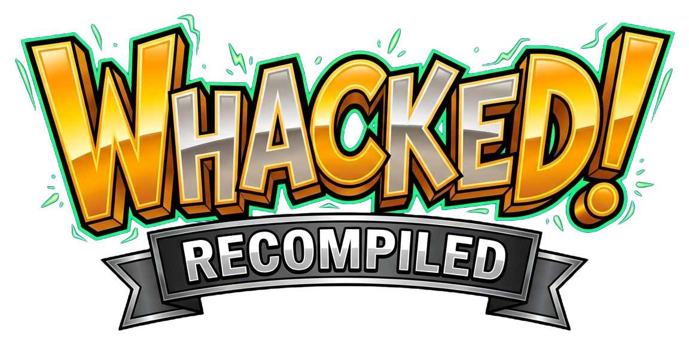

<p align="center">
  
</p>

<h3 align="center">Whacked! (Original Xbox, 2002) Static x86-to-x64 Recompilation for Windows and Linux</h3>

<p align="center">
  <a href="https://github.com/sageajnz-create/WhackedRecomp/actions/workflows/ci.yml"></a>
  <a href="https://github.com/sageajnz-create/WhackedRecomp/releases/latest"></a>
  
  <a href="LICENSE"></a>
</p>

<p align="center">
  <a href="https://recomplauncher.com/game/whackedrecomp"><picture><source media="(prefers-color-scheme: dark)" srcset="https://recomplauncher.com/assets/press/launcher/badge-light.svg"></picture></a>
</p>

> **Important:** This repository contains **zero copyrighted game assets, XBE binaries, keys, or disc images**. You must supply your own legally obtained copy of *Whacked!* (Original Xbox).

---

## How to Play

1. Download the latest release for your OS (`WhackedRecomp-*-Windows-x64.zip`, `WhackedRecomp-*-Linux-x64.tar.gz`, or `WhackedRecomp-*-Linux-x64.AppImage`), **or install directly via [RecompLauncher](https://recomplauncher.com/game/whackedrecomp)**.
2. Launch `WhackedRecomp` (`./WhackedRecomp` on Linux).
3. On the **Play & Setup** tab, supply your copy of *Whacked!*:
   - **Drag and drop** your `.iso` / `.xiso.iso` disc image (trimmed XISO or full Redump XGD1 DVD) or extracted game folder (`default.xbe`) directly onto the launcher window, **or**
   - Click **Browse...** (built-in cross-platform & controller-friendly picker) or **Auto-Find**.
4. Plug in any controller (Xbox, PlayStation DualSense/DS4, Nintendo Switch Pro) or use Keyboard controls.
5. Click **PLAY WHACKED!**.

### Supported Game Dumps
- Original Xbox **XISO** (`.iso`, `.xiso.iso`)
- Full **Redump DVD (XGD1)** `.iso`
- **Extracted game folder** containing `default.xbe` and disc data

---

## Features

- **Cross-Platform Graphics Backends**: Hardware **Direct3D 11** (Windows default) and **OpenGL 3.3 Core** (Linux default & optional `--renderer opengl` on Windows) with **4x MSAA**, **16x Anisotropic Filtering**, custom **NV2A shader translation** (HLSL 5.0 + GLSL 330 Core), and **DXBC / GLSL program binary disk caching**.
- **Widescreen, Ultrawide & HD Enhancements**: True **16:9 / 21:9 Hor+ widescreen**, optional **720p native Xbox mode flag**, optional **unstretched 4:3 HUD**, and a post-processing **FidelityFX-style CAS Sharpen & 8-tap Bloom** pass.
- **High-DPI Launcher & In-Game Overlay**: Built-in **Dear ImGui** startup launcher with bundled Xbox-themed artwork and **`F1` / Xbox Guide / `L3+R3`** in-game pause/settings overlay featuring full gamepad navigation, diagnostics/cache tools, and `F12` PNG screenshots.
- **RecompAchievements Ready**: Integrated `rl-achievements` (`rcheevos`) runtime supporting RetroAchievements memory rules, save-load protection, and live Rich Presence when launched via [RecompLauncher](https://recomplauncher.com).
- **Expanded 4-Player Controller Support**: SDL2 GameController auto-detection with hot-plugging, auto Xbox / PlayStation / Nintendo button glyphs, true 2D radial deadzones, camera sensitivity & Y-inversion controls, dual-motor haptic rumble, and customizable keyboard bindings.
- **Stereo Audio & Bink FMVs**: Real-time 44.1 kHz SDL2 stereo mixer with ADPCM/PCM decoding, DirectSound mix-bin stereo panning, soft-clip limiter, separate Master/SFX/Music sliders, and Bink video/audio playback.
- **Online & LAN Multiplayer (Virtual System Link)**: Zero-privilege virtual Xbox UDP router (`10.69.x.1` virtual IPs) supporting:
  - **LAN Multicast** auto-discovery between local/LAN instances
  - **Online Room Hosting & Joining** via shareable `WHK-XXXX-XXXX-XXXX` room codes or `IP:Port` (no root/admin required on Linux, includes optional UPnP & STUN external IP discovery)
- **Portable & OS-Native Storage**: Writes saves (`UDATA/`, `TDATA/`), settings (`whacked_config.ini`), caches (`cache/shaders/`), and logs (`logs/whacked.log`) cleanly inside `./userdata` (portable mode / `portable.txt`), `{data}` when launched by RecompLauncher, or OS per-user folders (`%APPDATA%\WhackedRecomp` on Windows, `~/.local/share/WhackedRecomp` on Linux).

---

## Quick Controls Reference

| Action | Gamepad | Default Keyboard |
| --- | --- | --- |
| Move | Left Stick | `W` / `A` / `S` / `D` |
| Camera | Right Stick | `I` / `J` / `K` / `L` |
| D-Pad | D-Pad | Arrow Keys |
| `A` / `B` / `X` / `Y` | `A` / `B` / `X` / `Y` (or Cross/Circle/Square/Triangle) | `Space` / `Left Shift` / `Q` / `E` |
| White / Black (`LB` / `RB`) | `LB` / `RB` | `C` / `V` |
| Left / Right Triggers | `LT` / `RT` | `F` / `R` |
| `Start` / `Back` | `Start` / `Back` | `Enter` (`Esc`) / `Tab` (`Backspace`) |
| **In-Game Overlay** | **Guide** or **`L3 + R3`** | **`F1`** |
| **Screenshot (PNG)** | — | **`F12`** |
| **Fullscreen Toggle** | — | **`Alt + Enter`** |

All keyboard bindings can be remapped interactively inside the **Controllers** tab.

---

## Online Multiplayer Guide

1. Open the **Multiplayer** tab in the Launcher (or press `F1` -> **Multiplayer** in-game).
2. **Host**: Choose **Host Online Room**, enter a UDP port (default `30740`), click **Start / Restart Host**, and click **Copy Code** to share your `WHK-XXXX-XXXX-XXXX` Room Code (make sure your UDP port is reachable or UPnP succeeded).
3. **Friends**: Choose **Join Friend's Room**, paste the `WHK-...` Room Code (or `IP:Port`), and click **Connect to Room**.
4. Inside *Whacked!*, navigate to **Multiplayer -> System Link** and create or join a lobby normally — peers across Windows and Linux appear automatically with live ping telemetry.

---

## Building from Source

### Windows (Visual Studio 2022/2026 + CMake + Ninja)
CMake automatically fetches SDL2 (`release-2.30.9`), Dear ImGui (`v1.91.9b`), `stb_image_write.h`, and `stb_image.h` (and compiles vendored `third_party/rl_achievements`).
```bat
call "C:\Program Files\Microsoft Visual Studio\18\Community\VC\Auxiliary\Build\vcvars64.bat"
cmake --preset windows-release
cmake --build --preset windows-release
ctest --test-dir build --output-on-failure
```
Output executable: `build\WhackedRecomp.exe`.

### Linux (Ubuntu / Debian / Arch / SteamOS)
Install build prerequisites (`cmake`, `ninja-build`, `pkg-config`, `libsdl2-dev`, OpenGL headers):
```bash
sudo apt install build-essential cmake ninja-build pkg-config libsdl2-dev libgl-dev
cmake --preset linux-release
cmake --build --preset linux-release
ctest --test-dir build_linux --output-on-failure
```
Output executable: `build_linux/WhackedRecomp`.

---

## Command-Line Options

```
WhackedRecomp [--game <iso-or-folder>] [--data <dir>] [--renderer auto|d3d11|opengl]
              [--width <px> --height <px>] [--widescreen 0|1] [--fullscreen 0|1]
              [--host <port> | --join <WHK-code-or-ip:port>]
              [--verify-iso <path>] [--no-launcher] [--launcher] [--help] [--version]
```

## License

MIT License — see [LICENSE](LICENSE). Third-party `rl-achievements`, `rcheevos`, and `cJSON` notices live under `third_party/rl_achievements/`.
